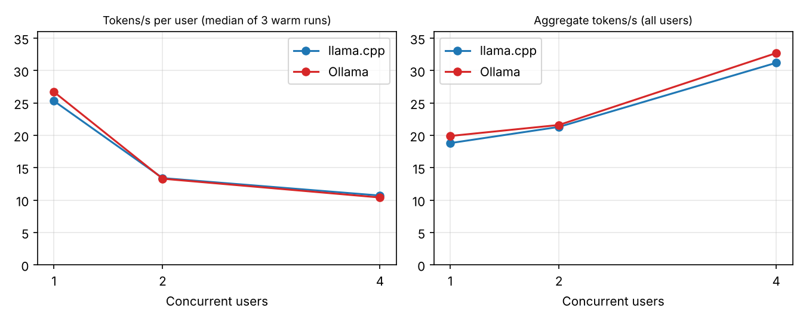

student@LAPTOP-8NEA8J2B:~/inference-fabric-scc26$ cp /mnt/c/Users/Student/Downloads/{results.md,run-log.md,tokens-vs-concurrency.png} evidence/week5/
python3 -I /mnt/c/Users/Student/Downloads/bench-pool.py evidence/week5/runs
## Pooled warm requests per tool and users (all repeats together; median / 95th percentile, nearest rank)

| tool | users | runs | requests | ok | TTFT s | total s | tokens/s | mean output tokens | mean prompt tokens |
|---|---|---|---|---|---|---|---|---|---|
| llamacpp | 1 | 3 | 60 | 60 | 1.76 / 3.21 | 7.16 / 10.95 | 25.38 / 29.36 | 121.6 | 402 |
| llamacpp | 2 | 3 | 60 | 60 | 1.84 / 6.16 | 12.58 / 21.81 | 13.37 / 20.06 | 125.2 | 402 |
| llamacpp | 4 | 3 | 60 | 60 | 1.98 / 3.44 | 14.93 / 26.91 | 10.85 / 17.05 | 117.4 | 402 |
| ollama | 1 | 3 | 60 | 60 | 1.76 / 3.19 | 7.76 / 11.10 | 26.72 / 32.80 | 131.4 | 402 |
| ollama | 2 | 3 | 60 | 60 | 1.84 / 3.25 | 13.90 / 23.15 | 13.39 / 19.00 | 134.3 | 402 |
| ollama | 4 | 3 | 60 | 60 | 1.94 / 4.79 | 16.90 / 31.16 | 10.42 / 18.50 | 140.6 | 402 |

## By prompt size (pooled): TTFT median s | tokens/s median | mean output tokens

| tool | users | short | medium | long |
|---|---|---|---|---|
| llamacpp | 1 | 0.20 s | 27.5 | 73 | 1.79 s | 25.4 | 167 | 3.16 s | 24.6 | 126 |
| llamacpp | 2 | 0.26 s | 14.3 | 78 | 1.87 s | 12.8 | 175 | 3.23 s | 11.9 | 122 |
| llamacpp | 4 | 0.73 s | 15.2 | 65 | 1.99 s | 10.9 | 165 | 3.34 s | 8.1 | 123 |
| ollama | 1 | 0.20 s | 29.8 | 83 | 1.80 s | 26.5 | 162 | 3.16 s | 25.7 | 152 |
| ollama | 2 | 0.28 s | 15.1 | 73 | 1.88 s | 13.1 | 174 | 3.21 s | 11.8 | 161 |
| ollama | 4 | 0.77 s | 14.9 | 84 | 1.98 s | 10.6 | 173 | 3.36 s | 8.6 | 169 |

## Answers cut off at the token limit (output tokens = 256), pooled

- llamacpp, 1 users: 4 of 60
- llamacpp, 2 users: 5 of 60
- llamacpp, 4 users: 1 of 60
- ollama, 1 users: 4 of 60
- ollama, 2 users: 7 of 60
- ollama, 4 users: 5 of 60

Failed requests: none
student@LAPTOP-8NEA8J2B:~/inference-fabric-scc26$student@LAPTOP-8NEA8J2B:~/inference-fabric-scc26$ cp /mnt/c/Users/Student/Downloads/{results.md,run-log.md,tokens-vs-concurrency.png} evidence/week5/
python3 -I /mnt/c/Users/Student/Downloads/bench-pool.py evidence/week5/runs
## Pooled warm requests per tool and users (all repeats together; median / 95th percentile, nearest rank)

| tool | users | runs | requests | ok | TTFT s | total s | tokens/s | mean output tokens | mean prompt tokens |
|---|---|---|---|---|---|---|---|---|---|
| llamacpp | 1 | 3 | 60 | 60 | 1.76 / 3.21 | 7.16 / 10.95 | 25.38 / 29.36 | 121.6 | 402 |
| llamacpp | 2 | 3 | 60 | 60 | 1.84 / 6.16 | 12.58 / 21.81 | 13.37 / 20.06 | 125.2 | 402 |
| llamacpp | 4 | 3 | 60 | 60 | 1.98 / 3.44 | 14.93 / 26.91 | 10.85 / 17.05 | 117.4 | 402 |
| ollama | 1 | 3 | 60 | 60 | 1.76 / 3.19 | 7.76 / 11.10 | 26.72 / 32.80 | 131.4 | 402 |
| ollama | 2 | 3 | 60 | 60 | 1.84 / 3.25 | 13.90 / 23.15 | 13.39 / 19.00 | 134.3 | 402 |
| ollama | 4 | 3 | 60 | 60 | 1.94 / 4.79 | 16.90 / 31.16 | 10.42 / 18.50 | 140.6 | 402 |

## By prompt size (pooled): TTFT median s | tokens/s median | mean output tokens

| tool | users | short | medium | long |
|---|---|---|---|---|
| llamacpp | 1 | 0.20 s | 27.5 | 73 | 1.79 s | 25.4 | 167 | 3.16 s | 24.6 | 126 |
| llamacpp | 2 | 0.26 s | 14.3 | 78 | 1.87 s | 12.8 | 175 | 3.23 s | 11.9 | 122 |
| llamacpp | 4 | 0.73 s | 15.2 | 65 | 1.99 s | 10.9 | 165 | 3.34 s | 8.1 | 123 |
| ollama | 1 | 0.20 s | 29.8 | 83 | 1.80 s | 26.5 | 162 | 3.16 s | 25.7 | 152 |
| ollama | 2 | 0.28 s | 15.1 | 73 | 1.88 s | 13.1 | 174 | 3.21 s | 11.8 | 161 |
| ollama | 4 | 0.77 s | 14.9 | 84 | 1.98 s | 10.6 | 173 | 3.36 s | 8.6 | 169 |

## Answers cut off at the token limit (output tokens = 256), pooled

- llamacpp, 1 users: 4 of 60
- llamacpp, 2 users: 5 of 60
- llamacpp, 4 users: 1 of 60
- ollama, 1 users: 4 of 60
- ollama, 2 users: 7 of 60
- ollama, 4 users: 5 of 60

Failed requests: none
student@LAPTOP-8NEA8J2B:~/inference-fabric-scc26$# Week 5 results: CPU inference, llama.cpp vs Ollama

Model: Qwen2.5-1.5B-Instruct, Q4_K_M. Both tools: 4 parallel slots, 4096 context per slot, 6 threads, 6 CPU / 6 GiB limits.
Servers on k8s-worker-01, benchmark harness on k8s-worker-02 (C8.medium, 8 vCPU / 16 GB, Intel Xeon Cascade Lake virtual, AVX2/AVX-512/VNNI, no AMX).
Workload: 20 fixed prompts (7 short, 7 medium, 6 long), temperature 0, max 256 output tokens, harness image digest `sha256:39592c92…36ab` (prompts sha256 `31b1f1c3…84e2`).
Every row below is the mean of three warm runs; the run IDs and their manifests are listed in `run-log.md`. All 20 runs completed, 20/20 requests ok each (cold runs 1/1).

## Warm results (3 runs per row)

TTFT = time to first token. p95 here is the mean of each run's own p95 (20 requests per run). Ranges across the three runs are in brackets.

| Tool | Users | TTFT median s | TTFT p95 s | Total median s | Total p95 s | Tokens/s per user | Aggregate tokens/s | CPU avg (cores) | Peak memory GiB | Runs |
|---|---|---|---|---|---|---|---|---|---|---|
| llama.cpp | 1 | 1.76 (1.76-1.77) | 3.19 | 7.22 (6.95-7.44) | 10.81 | 25.3 (24.9-25.8) | 18.8 | 5.81 | 2.61 | [w1](runs/llamacpp-c1-warm1-20261124/manifest.yaml) [w2](runs/llamacpp-c1-warm2-20261124/manifest.yaml) [w3](runs/llamacpp-c1-warm3-20261124/manifest.yaml) |
| llama.cpp | 2 | 1.84 (1.84-1.84) | 5.26 (3.24-6.38) | 12.24 (10.39-13.79) | 21.18 | 13.4 (12.7-13.8) | 21.3 | 5.32 | 3.41 | [w1](runs/llamacpp-c2-warm1-20261124/manifest.yaml) [w2](runs/llamacpp-c2-warm2-20261124/manifest.yaml) [w3](runs/llamacpp-c2-warm3-20261124/manifest.yaml) |
| llama.cpp | 4 | 1.97 (1.91-2.11) | 3.40 | 15.34 (14.75-15.84) | 26.71 | 10.7 (10.2-11.1) | 31.2 | 5.37 | 4.23 | [w1](runs/llamacpp-c4-warm1-20261124/manifest.yaml) [w2](runs/llamacpp-c4-warm2-20261124/manifest.yaml) [w3](runs/llamacpp-c4-warm3-20261124/manifest.yaml) |
| Ollama | 1 | 1.77 (1.76-1.79) | 3.18 | 7.85 (7.67-8.13) | 10.89 | 26.7 (26.2-27.3) | 19.9 | 5.81 | 2.13 | [w1](runs/ollama-c1-warm1-20261125/manifest.yaml) [w2](runs/ollama-c1-warm2-20261125/manifest.yaml) [w3](runs/ollama-c1-warm3-20261125/manifest.yaml) |
| Ollama | 2 | 1.84 (1.83-1.85) | 3.24 | 13.30 (11.86-14.37) | 22.18 | 13.3 (12.6-14.0) | 21.6 | 5.31 | 2.92 | [w1](runs/ollama-c2-warm1-20261125/manifest.yaml) [w2](runs/ollama-c2-warm2-20261125/manifest.yaml) [w3](runs/ollama-c2-warm3-20261125/manifest.yaml) |
| Ollama | 4 | 1.94 (1.93-1.95) | 4.68 | 17.13 (16.90-17.40) | 31.18 | 10.4 (10.1-10.7) | 32.7 | 5.05 (1 run only) | 3.69 | [w1](runs/ollama-c4-warm1-20261125/manifest.yaml) [w2](runs/ollama-c4-warm2-20261125/manifest.yaml) [w3](runs/ollama-c4-warm3-20261125/manifest.yaml) |

## Cold start (one run each, not comparable to the warm rows)

| Tool | Run | TTFT s | Total s | Tokens/s | What "cold" means for this tool |
|---|---|---|---|---|---|
| llama.cpp | [llamacpp-c1-cold1-20261124](runs/llamacpp-c1-cold1-20261124/manifest.yaml) | 0.28 | 0.77 | 34.5 | Model is loaded when the server starts (about 24.7 s, in `server-start.log`), so the first request is already fast. The server sat idle about 6 minutes first. |
| Ollama | [ollama-c1-cold1-20261124](runs/ollama-c1-cold1-20261124/manifest.yaml) | 18.18 | 18.73 | 33.0 | Model is loaded on the first request; that load is inside the TTFT. |

The two cold numbers measure different things. Loading costs roughly 18 to 25 s in both tools; llama.cpp pays it at start-up, Ollama pays it on the first request. A cold run is a single 1-request sample with a short answer, so its tokens/s should not be compared with warm rows.

## Chart

## What the numbers say

- Throughput is the same within noise. Per-user speed falls from about 25-27 tokens/s with 1 user to about 13 with 2 and 10-11 with 4. Aggregate throughput rises from about 19 to 21 to 32 tokens/s, so a 4-slot server gets about 1.7x the total output of one user, not 4x. The CPU is already near saturation (5 to 6 of the 6 allowed cores) at one user.
- Time to first token barely moves with concurrency (1.8 to 1.9 s median). Prefill of the 50 to 250 token prompts is fast; what grows with users is total time, because the decode slots share the same cores.
- Run-to-run spread is small (about 4 to 8 %), so differences of a few percent between tools are not meaningful. Ollama's higher total median at 4 users (17.1 s against 15.3 s) goes with longer answers and a different time of day (see caveats), so we do not claim a speed difference.
- Ollama p95 TTFT at 4 users (4.7 s against 3.4 s) is consistent in all three runs. It is the one difference that repeated; we have not investigated the cause.
- Memory grows with run order in both tools (llama.cpp 2.3 to 4.5 GiB, Ollama 1.8 to 3.9 GiB across the warm runs), so peak memory is not a clean per-concurrency figure. Take it as "stays under the 6 GiB limit for this workload".

## What each tool suits on CPU (this workload)

| | llama.cpp server | Ollama |
|---|---|---|
| Warm speed, 1 to 4 users | Same as Ollama within noise | Same as llama.cpp within noise (it runs llama.cpp underneath; `ollama ps` shows RUNNER llamacpp) |
| First request after start | Fast (model preloaded; ~25 s start-up) | Slow (about 18 s for the first request) unless kept loaded (`OLLAMA_KEEP_ALIVE=-1` here) |
| Control | Direct flags (threads, slots, context, cache) and server log | Fewer knobs, set by environment and Modelfile |
| Operations | One model per server, you manage the GGUF file | Pulls and manages models, easier to swap models |
| Suits | Fixed model, predictable start-up, tuning | Several models, quick set-up, trying models out |

On this hardware neither tool is the faster choice, so the choice is operational. GPU serving (vLLM) was not tested and is deferred.

## Caveats

1. **Prompt cache fixed during the work.** llama.cpp skips prefill for repeated prompts. Two early check runs were invalid because of a duplicated prompt and cross-run cache hits; these were fixed (PR #120, PR #121). Every prompt now carries a short per-run tag (`[ref <8 hex>] `, 10 to 13 tokens) so no run can reuse another's cache. The failed check runs stay in `run-log.md`.
2. **Answer lengths differ** between runs and tools (the tag changes the text slightly), so total latency and tokens/s are not like-for-like across tools. TTFT is the cleanest comparison.
3. **Memory is confounded by run order**: llama.cpp's host prompt cache grows about 0.27 GiB per run, and Ollama's memory also rises across its runs. The Ollama cold row (0.12 GiB) was sampled before the model loaded.
4. **Missing CPU/memory samples**: Prometheus scrapes about once a minute, so the cold runs have no CPU figure, and two Ollama 4-user runs (warm2, warm3) have none either; the Ollama 4-user CPU value is one run.
5. **Quiet-node checks**: all runs started with the 1-minute load under 1.0 on the server node, but three were borderline (0.97, 0.98, 0.83); see `quiet-node.txt` in each run folder.
6. **Different times of day**: llama.cpp ran on 2026-11-24 (afternoon), Ollama on 2026-11-25 (morning). The VM is shared, so neighbour load may differ.
7. **Same model, different downloads**: both use Qwen2.5-1.5B-Instruct Q4_K_M, but the files come from different sources and their hashes differ (recorded in the manifests).
8. p95 columns are the mean of per-run p95 over 20 requests, so they are rough. Pooled percentiles over all 60 requests are in the last section.
9. GPU/vLLM runs were not done.

## Pooled percentiles (all 60 warm requests per row, nearest-rank p95)

| Tool | Users | TTFT median / p95 s | Total median / p95 s | Tokens/s median / p95 | Mean output tokens | Answers cut at 256 tokens |
|---|---|---|---|---|---|---|
| llama.cpp | 1 | 1.76 / 3.21 | 7.16 / 10.95 | 25.4 / 29.4 | 121.6 | 4 of 60 |
| llama.cpp | 2 | 1.84 / 6.16 | 12.58 / 21.81 | 13.4 / 20.1 | 125.2 | 5 of 60 |
| llama.cpp | 4 | 1.98 / 3.44 | 14.93 / 26.91 | 10.9 / 17.1 | 117.4 | 1 of 60 |
| Ollama | 1 | 1.76 / 3.19 | 7.76 / 11.10 | 26.7 / 32.8 | 131.4 | 4 of 60 |
| Ollama | 2 | 1.84 / 3.25 | 13.90 / 23.15 | 13.4 / 19.0 | 134.3 | 7 of 60 |
| Ollama | 4 | 1.94 / 4.79 | 16.90 / 31.16 | 10.4 / 18.5 | 140.6 | 5 of 60 |

All 360 warm requests succeeded. Prompts averaged 402 tokens including the tag.

By prompt size, TTFT median (s) at 1 / 2 / 4 users:

| Tool | Short | Medium | Long |
|---|---|---|---|
| llama.cpp | 0.20 / 0.26 / 0.73 | 1.79 / 1.87 / 1.99 | 3.16 / 3.23 / 3.34 |
| Ollama | 0.20 / 0.28 / 0.77 | 1.80 / 1.88 / 1.98 | 3.16 / 3.21 / 3.36 |

Reading the pooled numbers:
- TTFT is set by prompt length (about 0.2 s short, 1.8 s medium, 3.2 s long), not by the tool. The only concurrency effect is on short prompts at 4 users (0.2 to 0.75 s), which wait for a free slot.
- Ollama's answers are 8 to 20 % longer on average (131 to 141 tokens against 117 to 125), which explains most of its higher total latency. Per-token speed is within 5 % (26.7 against 25.4 tokens/s at 1 user, equal at 2).
- The llama.cpp 2-user p95 TTFT of 6.2 s comes from two of its three runs (warm2, warm3) and did not repeat in the Ollama 2-user runs, so we treat it as an outlier. Ollama's 4-user p95 TTFT (4.8 s against 3.4 s) repeated in all three runs.
